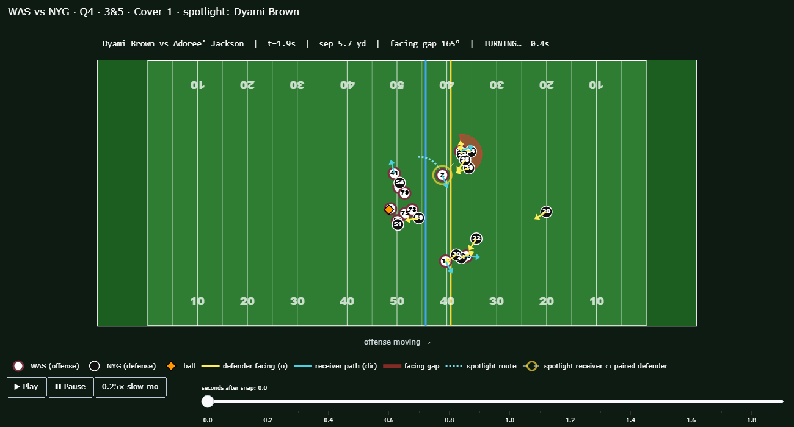

# Turn Lag: the route-running win that separation stats miss

> Existing receiver metrics score the outcome — how open he was. Turn Lag scores the mechanism — how long he left the man covering him turned the wrong way.

**Audience:** scouts and coaches evaluating route running against man coverage; broadcasters who want to show *how* a route won.

**Live dashboard:** **https://lilnewbie.github.io/NFL-BDB-26-NYU/**

**Deliverable:** `docs/index.html` (published at the link above, and also written to `out/dashboard.html` locally), one self-contained page (works offline) with animated replays, a written insight for each replay, a receiver leaderboard, a scatter against separation, and a flip-side defender table.



## What it measures

NFL tracking records two angles per player: `dir` (where he is moving) and `o` (where his shoulders face, from the shoulder-pad sensors). After a receiver breaks, a defender who is still facing the old path is beaten, even if the separation number has not caught up yet. For every route against man coverage we:

1. **Window:** snap (`ball_snap`, else `autoevent_ballsnap`) to throw (`pass_forward`, else `autoevent_passforward`). The data ends ~0.3 s after release, so nothing after the throw is used.
2. **Normalize** left-moving plays by a true 180° rotation (x → 120−x, y → 53.3−y, angles +180°), then smooth `o` and `dir` with a 3-frame circular mean.
3. **Pair** each route runner (`pff_role == "Pass Route"`, WR/TE/RB) with the closest `Coverage` defender over the first second after the snap. Only cornerbacks, safeties and linebackers can be paired: PFF also tags linemen who drop into coverage as `Coverage`, and they are spying or sinking into a short zone, not covering a receiver.
4. **Break:** the largest 0.5 s change in the receiver's direction, at least 30°, with peak speed above 2 yd/s in that span. Routes are bucketed as slight (30–60°), sideways, back toward the line, or diagonal downfield.
5. **Gap(t):** the angle between the paired defender's shoulders and the receiver's current path, from the break to the throw.
   - **Turn Lag:** seconds until the gap drops below 45°. If it never does, the lag is capped at the throw and the route is flagged as censored.
   - **Mean Gap:** the average gap from the break to the throw.
6. **Over Expected:** subtract the average for the same coverage type, receiver position, defender type (defensive back or linebacker) and break bucket, so a receiver is not rewarded for running route types, or drawing defender types, that always look turned. Defender type matters because the man/zone label is per play: on a man-coverage play some linebackers still drop into zones and face the quarterback.

**Headline choice.** 49% of man-coverage routes are censored (the defender never turned before the ball came out). That is above the 30% limit set before the run, so time-to-turn is capped on most reps. The headline is therefore **Mean Gap Over Expected**, which has no cap. Turn Lag is still shown in the replay timer and the tables.

## Results (all 122 games, 2021 Weeks 1–8)

| Step | Count |
|---|---|
| Plays | 8,557 (974 dropped: no snap or no throw, e.g. sacks, scrambles) |
| Skill-position routes | 34,654 |
| No break before the throw (go routes, quick throws) | 21,061 |
| Paired defender more than 5 yd away at the break (pairing no longer valid) | 6,886 |
| **Routes scored** | **6,707** (2,774 against man coverage) |
| Receivers with ≥15 man routes | 63 |

502 player-plays where a lineman was tagged `Coverage` were left out of pairing (step 3).

**Top 10 vs man coverage (Mean Gap Over Expected):** Ricky Seals-Jones +18.4°, Cooper Kupp +14.6°, Courtland Sutton +11.7°, Tajae Sharpe +11.5°, Hunter Henry +10.9°, Olamide Zaccheaus +9.9°, Jakobi Meyers +9.7°, Noah Fant +9.6°, Chris Godwin +9.5°, Bryan Edwards +7.9°. Justin Jefferson (16th) and CeeDee Lamb (21st) are also in the top 25. Full table: `out/leaderboard.csv`.

**Insight.** Turning a defender and being open at the throw are related but different skills. At the player level the correlation between the two is only **r = +0.14** (+0.15 per route). The scatter's lower-right quadrant holds receivers who turn their man but are not open when the ball comes out, such as Courtland Sutton and Tajae Sharpe (3rd and 4th on the leaderboard, with 1.8 and 1.9 yd average separation). Catch-point separation undersells their route running; quarterback timing or play design is the likelier place to look.

**Validation (required check).** If the metric were secretly rewarding good coverage, it would correlate with "defender ahead of the receiver at the throw" (a corner staying over the top faces away from a receiver who is behind him). The route-level correlation is **r = +0.08**, so it is not measuring that.

**Defensive side (sanity check, not proof).** Read from the defense, the metric uses no coverage assignment data, and none of the tuning described below looked at this table. Among the 60 defenders paired on at least 15 man routes, the ones whose receivers turned them least are Justin Coleman, Janoris Jenkins, Byron Murphy, Byron Jones, Paulson Adebo and Marshon Lattimore, all established starting corners. Defenders who get turned more also give up more separation at the throw (r = +0.36 across the 60). Two cautions. Most of the table is starters, because only defenders who see many man routes qualify, so familiar names at the top prove little on their own. And some highly rated 2021 corners rank poorly: J.C. Jackson is 43rd and A.J. Terrell 57th, though Terrell allowed only 1.3 yd of separation. Full table: `out/cb_leaderboard.csv`.

**Featured replays.** The dashboard's showcase reps are limited to a cornerback on a wide receiver with at most 6 yd of separation at the throw, so every featured rep is an unambiguous man matchup. This affects only which replays are shown, not any number above.

## Caveats

- **Shoulders, not hips.** `o` comes from shoulder-pad sensors, so the metric measures where the defender's shoulders face.
- **Pairing is a heuristic.** The data has no defender-to-receiver assignments. Routes where the early-snap pairing is more than 5 yd away at the break are excluded, and linemen are never paired.
- **Man coverage only** for the headline numbers. Zone defenders are taught to face the quarterback, so their facing says little about the route. The man/zone label is per play, so a man-coverage play can still contain linebackers dropping into zones; comparing linebacker pairings only with each other reduces this but does not remove it.
- **Association, not causation.** A defender still turned after a break is consistent with the route beating him, but not proof of it.
- **Small samples.** 15–38 qualifying routes per receiver across 8 weeks. Treat the ranks as directional, not as a grade. No running back reached 15 qualifying routes once distant pairings were removed.
- **Thresholds** (30° break, 2 yd/s, 45° turned, 30% censoring limit) were set before the full run. Four changes were made after looking at results, and are disclosed here:
  - The mean-speed gate became a peak-speed gate after it rejected most curls and comebacks.
  - Position was added to the Over Expected baseline after running backs filled the leaderboard (backs are usually paired with linebackers who keep facing the quarterback).
  - The 5 yd pairing filter was added after a replay showed a defender 13 yd away being credited as beaten.
  - After review, linemen were removed from pairing and defender type was added to the baseline. A featured replay paired a wide receiver with a dropping defensive end who ended 17.9 yd away. Linebacker pairings averaged +16° over expected against −2° for cornerbacks, which pointed to linebackers dropping into zones rather than receivers beating them.
  - A "separation at the throw grew too much" filter was considered and rejected, because it filters on an outcome: it would remove the biggest genuine wins and bias the separation correlation reported above.

## Prior art

- **NGS Average Separation and Cushion:** distance to the nearest defender at the catch and at the snap.
- **ESPN Receiver Tracking Metrics / Open Score:** openness relative to expectation, including untargeted routes.
- **NFL Ghosts' `o_wrt_rec_diff`:** defender orientation relative to the receiver, used as a feature inside a defender model.
- **BDB 2026 reaction-time work** and **deepfootball's Recovery metric.**

Defender reaction time after a route break has been measured before, via positional convergence (see BDB 2026 reaction-time work; deepfootball's Recovery metric). Turn Lag measures it in the orientation channel — where the defender's shoulders point, from the shoulder-pad sensors — and attributes the delay to the receiver who caused it rather than scoring the defender.

The 2023 Big Data Bowl that produced this dataset focused on linemen and pass rush, so receiver orientation work is outside its findings.

## Run it

```powershell
python -m venv .venv
.\.venv\Scripts\python.exe -m pip install -r requirements.txt
.\.venv\Scripts\python.exe -m src.run_all          # scores all 122 games (~25 s), writes out/routes.csv
.\.venv\Scripts\python.exe -m src.build            # leaderboard, validation, out/dashboard.html + docs/index.html
.\.venv\Scripts\python.exe -m src.demo_play 2021090900 97   # single replay, out/play_<game>_<play>.html
.\.venv\Scripts\python.exe -m pytest -q
```

Data is read from `nfl-big-data-bowl-regional-event-data/data/` and is not modified.

| File | Role |
|---|---|
| `src/data.py` | loaders, direction normalization, angle smoothing, snap-to-throw window, `o` sanity check |
| `src/angles.py` | circular-angle helpers (NGS convention: 0° = +y, clockwise) |
| `src/metric.py` | pairing, break detection, buckets, Turn Lag, Mean Gap, Over Expected |
| `src/viz.py` | animated Plotly field, facing arrows, gap wedge, live readout |
| `src/insight.py` | per-play written insight |
| `src/run_all.py`, `src/build.py` | batch scoring, aggregation, dashboard |

**`o` sanity check:** at the snap, 98% of offensive players and 97% of defenders face their expected direction after normalization, so `o` is usable and the `dir` fallback was not needed.
